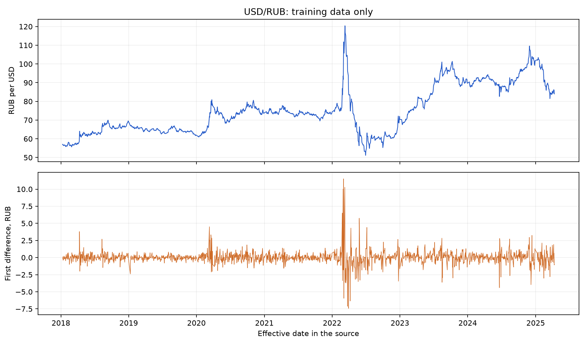
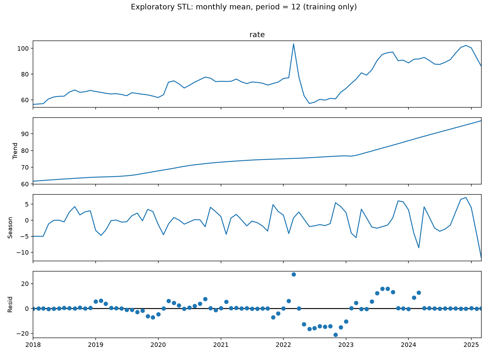
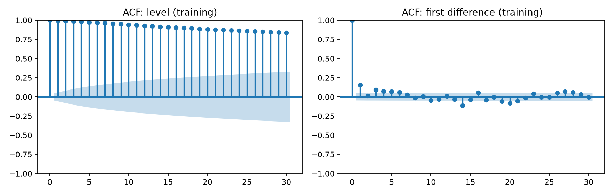
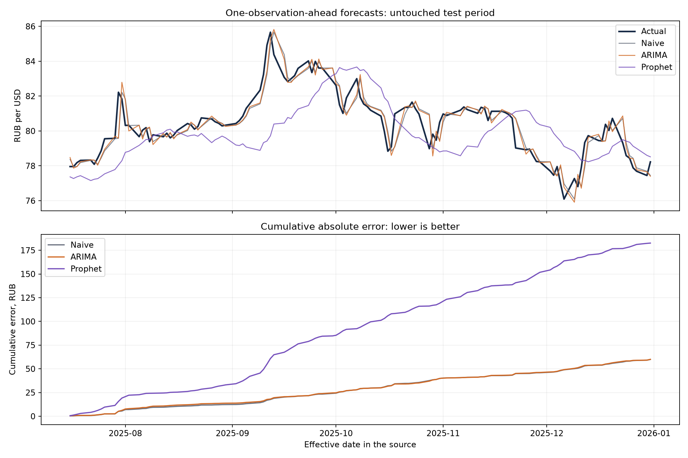

# Можно ли предсказать следующее значение USD/RUB лучше последнего известного курса?

## Результат

На этом test-периоде сложные модели не превзошли последнее известное значение. Для этого горизонта выбираем простой baseline.

| Модель | WAPE, % | MAE, ₽ | RMSE, ₽ | Улучшение MAE к baseline, % |
| --- | ---: | ---: | ---: | ---: |
| Naive | 0.621 | 0.499 | 0.691 | +0.00 |
| ARIMA | 0.622 | 0.500 | 0.692 | -0.18 |
| Prophet | 1.892 | 1.521 | 1.844 | -204.81 |

WAPE = 100 × Σ|факт − прогноз| / Σ|факт|. MAE выражена в рублях за один доллар. Положительное улучшение означает меньшую ошибку, отрицательное — ухудшение. Все модели оценены на одних и тех же 120 наблюдениях. Малая WAPE уровня курса сама по себе не означает, что модель умеет предсказывать изменения курса.

## Данные

- Источник: [XML API Банка России](https://www.cbr.ru/development/sxml/), USD, код R01235.
- Фактический интервал: 2018-01-10 — 2025-12-31, 1973 наблюдений.
- Обучение до validation: по 2025-04-12 включительно.
- Validation: 2025-04-15 — 2025-07-15, 60 наблюдений; оценка каждого пятого (12 точек).
- Test: 2025-07-16 — 2025-12-31, 120 последовательных прогнозов.
- SHA-256 исходного XML: `308b37023347db2478c2493377181a318e22f81afb269acd2f1930d5eb8b4bc1`.

Номинал нормализован к одному доллару. Проверены типы, уникальность дат, положительность и конечность значений. Выходные не дополняются повторениями курса, реальные скачки не удаляются.

## Метод

Для каждой точки используется окно из предыдущих 750 наблюдений. Горизонт — одно следующее наблюдение. После появления фактического значения окно сдвигается; параметры моделей переоцениваются. Будущие значения не попадают в обучение. Даты являются датами действия официального курса из источника; время его публикации в XML отсутствует. Это исследование последовательности исторических наблюдений, а не воспроизведение доступного в реальном времени обмена валют.

Сетка ARIMA: [(1, 0, 0), (1, 1, 0), (0, 1, 1), (1, 1, 1)]. Две настройки Prophet: [{"changepoint_prior_scale": 0.01, "yearly_seasonality": false}, {"changepoint_prior_scale": 0.05, "yearly_seasonality": true}]. Победитель каждой семьи выбран по WAPE на validation и сохранён до расчёта test. Все преобразования ряда для анализа рассчитаны только по исходной обучающей части.

Выбраны: ARIMA(1, 1, 0); Prophet `{"changepoint_prior_scale": 0.05, "yearly_seasonality": true}`. При несходимости ARIMA повторяет оптимизацию Powell на том же обучающем окне; дальнейшая несходимость завершает расчёт ошибкой. Предупреждения сохраняются вместе с прогнозами.

## Анализ ряда

ADF на уровне курса: p = 0.2348; на первых разностях: p = 8.53e-13. Нулевая гипотеза ADF — единичный корень. Результат теста зависит от спецификации и структурных сдвигов, поэтому не является доказательством будущей точности модели. Ряд первых разностей построен отдельно; фактические курсы сохранены.

В обучающей части отмечено 35 изменений за пределами среднего ± 3 стандартных отклонения; они оставлены в данных. Это диагностическая отметка, а не правило очистки.

STL применяется к среднему курсу по месяцам обучающей части с периодом 12; последний неполный месяц исключён. Она разделяет ряд на тренд, условную сезонную компоненту и остаток, но сама по себе не подтверждает устойчивую сезонность. ACF дополнительно показывает автокорреляцию уровня и разностей.

## Вывод для продуктовой задачи

Этот кейс проверяет, стоит ли усложнять прогнозный компонент валютного сервиса. Решение зависит от выигрыша к простому правилу и стоимости сопровождения; качество на одном периоде не гарантирует такого же результата в другом режиме рынка. Для функции уведомлений или планирования бюджета понадобятся другие горизонты, проверка на нескольких периодах и оценка пользы для пользователя.

Внешние регрессоры не используются, поэтому причины движения курса и влияние новостей/ставки не установлены. Прогнозируется официальный справочный курс, а не курс покупки/продажи банка. Интервалы неопределённости и статистическая значимость различий ошибок в эту версию не входят. Результат не переносится автоматически на другие валюты или горизонты.

## Формулировка для анкеты

«Разработал воспроизводимый проект прогнозирования официального USD/RUB на открытых данных Банка России: проверил качество данных, исследовал стационарность и декомпозицию ряда, сравнил ARIMA и Prophet с наивным прогнозом. Выбрал параметры на отдельном validation-периоде и оценил модели на 120 последовательных test-наблюдениях без утечки будущих значений. Лучшая WAPE на test — 0.621% (Naive); описал ограничения и целесообразность усложнения модели».
